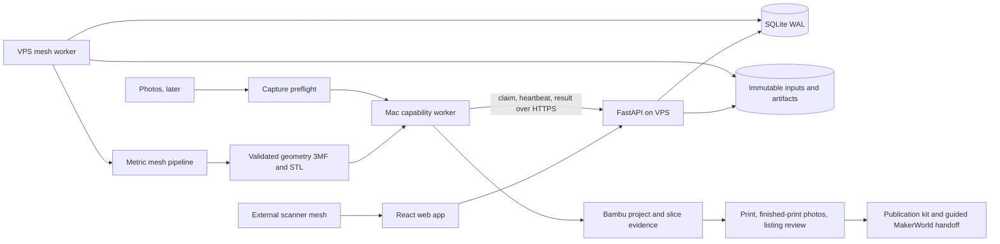

# Architecture

Status: proposed delivery revision, 2026-10-31. This document describes the target system. Only the scaffold and identity runner exist at reviewed `main` commit `17491ecd4729be807e4359a1a77e77c6c7c7822d`. See [current assessment](REVIEW.md), [delivery plan](IMPLEMENTATION_PLAN.md), and [research evidence](research/scan-to-publication.md).

## 1. Goal and product boundary

Turn an externally captured physical object scan into a validated model, a Bambu Studio project, a tested P1S print, and a prepared MakerWorld publication with minimal file handling and repeated entry. MakerWorld publication is part of the main delivery path. Native capture and photo reconstruction follow the scan-file path.

The browser displays geometry and collects user intent. Authoritative measurement, geometry processing, validation, comparison and export run in the pipeline or a versioned worker adapter. Build a coherent preparation workflow rather than a general mesh editor. Keep MeshLab and slicers useful as advanced escape hatches, with returned files imported as new revisions.

Preserve capture evidence, real measurements and matched-camera views, following the useful separation in [3d-model-anything](https://github.com/wesbos/3d-model-anything). Decorative reproduction is the first delivery path. Functional-part CAD reconstruction is separate, with stronger dimensional and feature checks, never an implied accuracy guarantee.

## 2. Failure modes and evidence gates

| Risk | Required behavior |
| --- | --- |
| Unknown or wrong units | Resolve scale before any operation with millimetre thresholds. Never infer scale from a plausible bounding box alone. |
| A hole or cavity is filled during repair | Distinguish defects from intended openings. Protect selected regions and compare sections before accepting repair. A closed manifold can contain a through-hole or cavity. |
| One dimension matches but the object is distorted | Support several measurements, residuals and independent checks. Uniform scale cannot fix nonuniform distortion. |
| Scan detail is lost during cleanup or simplification | Retain the input and alternatives. Show removed components, filled regions, deviation and qualified volume changes. |
| Geometry validation passes | Report only the checks actually run. This does not establish dimensional accuracy, slicing success or physical print success. |
| Slicer succeeds | Record version, settings, output and warnings. A successful slice does not establish a successful physical print. |
| Geometry or settings change after printing | Preserve the tested project. Mark the new revision as not test-printed. |
| Large mesh exhausts a 4 GB VPS | Bound input decoding and processing, measure peak memory including copies and exporters, reject or route unsupported jobs. |
| Gaussian splat or point cloud supplied as a scan | Inspect content for actual surface faces. Explain the required mesh export; a `.ply` suffix alone is insufficient. |
| Appearance disappears | Keep original textures, materials, UVs and colours. Track survival through each conversion before promising colour export. |

No numerical real-photo accuracy range is established. A synthetic scaling tolerance is a regression check, not a claim about consumer scan accuracy.

Use separate evidence states with artifact hashes and timestamps:

1. **Geometry validated:** named topology, volume, intersection, bed-fit and orientation checks passed for a model revision.
2. **Dimensions checked:** measurements, scale method, residuals, tolerances and unresolved disagreements recorded. Target-size resizing is labelled decorative sizing.
3. **Slicing verified:** a pinned slicer processed that exact project with recorded settings and outcomes.
4. **Physical print verified:** the user records a successful print from that project revision and genuine photographs of the finished print. An original-object photo is reference evidence only.
5. **Publication verified:** the actual published model/profile identifiers, URL and uploaded revision are recorded. A draft or accepted upload is not a published listing.

Missing, failed and not-applicable checks remain explicit. Required checks that were not run block validated export; optional checks are labelled separately. Diagnostic exports, if retained from #14/#15, live separately, are marked unvalidated and cannot enter project generation or publication readiness.

## 3. System overview and compute placement



### 3.1 Worker responsibilities

- **VPS:** API, static web app, SQLite WAL and local artifacts; initially one memory-bounded mesh job at a time. SQLite stays on the VPS, remote workers use the API. Short transactions allow API and worker writes on that host.
- **Mac:** initial Bambu Studio project generation and slicing. Later the preferred full-detail photo reconstruction worker. Share the capability/lease transport, keep Bambu and Apple Object Capture adapters separate. No inbound connection to the Mac is required.
- **Offline Mac:** show a waiting reason. Do not silently substitute settings, reconstruction method or an unverified VPS slicer. Users can still obtain validated geometry exports.
- **VPS photogrammetry:** deferred, benchmark-gated COLMAP/OpenMVS fallback (#22). It is not required for the main scan-file or Mac photo exits. No fixed image-count or quality promise before measurement.
- **Native iOS:** later capture client (#25/#34), with requirements verified against current Apple documentation at implementation time. Mobile web uploads work before native capture.

### 3.2 Resource envelope

The intended VPS is ARM64 with about 4 GB RAM. Roughly 1 GB for services and 3 GB for a job is a planning budget, not a measured operating limit. #21 must record actual hardware, base image, library versions, input sizes, peak process and container memory, wall time, swap, temporary disk and failures. Include mesh copies in `Mesh.copy()`, spatial indexes, repair, comparison, preview and export. Set supported input limits from those results.

Bound file size and archive expansion before parsing. Decode unknown meshes in a limited subprocess because counting faces after loading can already exceed memory. Reject over-limit files with re-export guidance. Early simplification is optional and separately recorded; it must not silently sacrifice protected detail to fit the host. Millimetre deviation bounds require known scale. A preview is never the authoritative processing mesh.

## 4. Components and pipeline

### 4.1 `apps/web`

React, TypeScript strict, Vite; TanStack Query, React Router and React Three Fiber remain planned additions. Use the existing feature folders, CSS modules and design tokens. Generate API types from FastAPI OpenAPI.

The guided view presents the next unresolved decision: size, repair review, base/orientation, warnings, print settings, test print or publication details. It preserves advanced controls and alternative branches. Reuse #19 stage comparison and #20 intent/rerun controls. The UI sends selections in the authoritative artifact coordinate system with its revision identifier. It does not calculate authoritative dimensions or repairs from the lightweight GLB.

### 4.2 `services/api` and workers

FastAPI handles authenticated jobs, bounded resumable uploads, parameters, reviews and artifact access. SQLite stores ownership, job/stage states, worker capabilities, leases and committed artifact references. Extend the same contract for recipes, projects, print evidence and listings. Use scoped tokens for workers, cookie sessions with CSRF protection for web writes, and invite-only access (#16/#32/#33).

**Auth (#32), implemented:** invite-only accounts (`python -m scan3d_api.admin invite --admin` bootstraps the first admin), scrypt password hashes, HttpOnly SameSite=Strict session cookies with a per-session CSRF header on unsafe methods, and hashed bearer tokens of kind `device` (jobs and uploads) or `worker` (claim and complete only). Jobs are owned and invisible to other users. Not yet implemented: login rate limiting.

Worker results require the current lease and expected input revision. Expired or duplicate completions cannot advance a job. Cancellation occurs between stages and through subprocess termination for external tools. API requests never perform mesh processing. Uploaded archives and tool invocations use safe paths, fixed executable adapters and structured arguments.

### 4.3 `services/pipeline`

Keep pure geometry stages `(mesh, params) -> StageResult(mesh, report)`. File import, reconstruction, slicing and publication packaging are orchestration adapters rather than pretending every operation is a mesh-to-mesh function.

```text
scan file -> ingest -> normalize axes/declared units -> resolve scale
  -> clean -> repair -> orient/base -> decimate -> validate -> geometry export
  -> Bambu project -> slicer verification -> test print -> publication kit

photos, later -> preflight -> Mac reconstruct -> ingest -> same mesh path
```

| Step | Contract and review behavior |
| --- | --- |
| Ingest (#9) | Detect surface mesh by content, flatten scene transforms without implicit repair; report source units, appearance and counts. Preserve originals and archive sidecars. Start with GLB/PLY, add OBJ/glTF/USDZ through format fixtures. |
| Normalize (#10) | Convert declared units and axes once, retain inverse transform and provenance. Unknown units remain unknown. +Z is up after normalization. |
| Resolve scale (#12, early entry point) | Establish metric coordinates from declared/sensor units with provenance, a measured reference, explicit factor or decorative target size. Block millimetre operations if unresolved. |
| Clean (#10) | Apply metric plane/component thresholds only after scale. Propose removals, retain removed geometry and respect protected regions. Never keep only the largest part without reporting the others. |
| Repair (#11) | Classify boundary defects, fix winding and local defects conservatively. Filling/remeshing requires a reviewed proposal where features may change. Unsupported constraints or excessive deviation stop for review. |
| Orient/base (#12, later entry point) | Suggest stable bases; record the selected rigid transform. Base cuts and caps are destructive repairs, with protected-region and deviation checks. Drop to Z=0. |
| Decimate/validate (#13) | Bounded simplification, preserve features/topology, revalidate after cuts and decimation. Publish warning coverage and uncertainty, including thin-wall sampling. |
| Geometry export (#14) | Millimetre core 3MF plus optional binary STL and validation report, bound to the validated mesh hash. STL units are carried in the companion manifest. Library choice follows the ARM64 spike. |

Split the scale and orientation implementation within #12 into separately mergeable work. Early scale depends on ingest and normalization, not repair. Orientation depends on repair. This removes the old repair-before-scale ordering and its dependency cycle.

For multiple scale references let `d_i` be a positive source distance and `L_i` the measured length in mm. With explicit positive weights, fit one scale `s = sum(w_i*d_i*L_i) / sum(w_i*d_i*d_i)`. Record each `s*d_i - L_i` residual in mm and relative terms. Validate finite values, reject zero-length selections, do not silently discard outliers. Let the user classify calibration versus held-out checks. Warn on disagreement using recorded per-check tolerances; unresolved critical failures block dimensional approval. If source coordinates are already in mm, `s` is an explicit correction, never a second implicit unit conversion.

Store selections against immutable full-mesh revisions using coordinates and an explicit mapping from preview picks. Face indices alone do not survive remeshing. Protect openings/cavities/regions using spatial constraints and section/clearance checks. Remap or mark a constraint unresolved after topology changes. Watertightness and surface distance alone cannot prove a mounting hole survived.

Extend #11/#19 reports with bidirectional sampled surface deviation in mm, sampling method/count and limitations, filled patches, removed components, bounds and cross-sections. Only compare in a shared metric frame; distinguish deliberate scaling/rigid placement from surface edits. Volume deltas require valid closed inputs on both sides, otherwise show unavailable. Do not label a sampled maximum as an exact Hausdorff bound. Retain the original comparison as well as adjacent stages to expose accumulated loss.

### 4.4 External adapters

- **Bambu project:** use a pinned Bambu Studio executable and full resolved printer, nozzle, plate, material and process configurations. Official CLI documentation supports loading settings, arranging, slicing and project export. #29 verifies the exact Mac invocation and output before the production adapter is built. See the [evidence ledger](research/scan-to-publication.md).
- **Slicing:** run on the exact generated project without hidden orientation/configuration updates. Record final mesh placement, executable version/checksum, configuration hashes, command arguments, exit status, logs, available time/material/support estimates and missing estimates. An adapter/configuration change invalidates downstream slice evidence.
- **Reconstruction, later:** a shared reconstructor contract is extracted from #22 into #23, so the Mac path does not depend on building the VPS fallback. Metric sensor metadata is evidence, not proof of accuracy; plain photo results still need scale checks.
- **Preflight:** shared by future photo upload and Mac reconstruction, not trapped inside the VPS adapter. Detect blur, exposure, duplicates and undersized/corrupt images; show affected photos and retake advice. Preserve originals, decisions and QC version. Image quality alone does not prove geometric coverage.

### 4.5 Native capture, later

SwiftUI/RealityKit capture can upload a surface mesh or a raw photo/depth/pose bundle through the same API. Verify supported hardware and OS, build on macOS CI and document real device checks. The app is not a prerequisite for finished-print photo upload or the first publication.

### 4.6 Agent skill, CAD and MCP, later

Reuse #26 for the agent skill and #27 for functional reconstruction. Keep STEP and editable CAD recipes with deterministic dimension, opening, cavity and cross-section gates separate from decorative mesh repair. Build123d and CadQuery are candidates to evaluate, not new commitments. Add MCP only after inspection, measurement, rerun, comparison and export operations have stable validated contracts. Agents use these operations, never bypass artifact or validation gates.

## 5. Data and revision contracts

### 5.1 Capture evidence

`capture-bundle/1` remains proposed, not an implemented import contract. It includes a versioned manifest, source/device, file hashes, declared units and scale provenance, images, optional depth/poses/intrinsics and an optional surface mesh. Document pose conventions when #23/#35 can verify them. Preserve originals privately, with appearance sidecars and source/license attribution. Point clouds and Gaussian splats need a separately verified reconstruction path.

### 5.2 Atomic stage commits and reproducible recipes

**Current runner:** one-based `stages/01-identity/{mesh.ply,preview.glb,report.json}`, `start_from` loads the previous PLY with `process=False`. It isolates inputs with copies and records supplied parameters and duration. PLY reload has float32 precision; previews currently contain the full mesh. It does not implement atomic completion, hashes, branches or job state.

**Next contract:** stage attempts write into unique temporary directories on the same filesystem. Serialize, close and verify all artifacts, record their hashes and write a completion manifest, then atomically rename to a new immutable attempt directory. Publish a small current-reference manifest with atomic replacement. Never replace a populated stage directory in place. Readers resume only from the published manifest and verified outputs. A failed rerun leaves the prior committed attempt intact. Old layouts require an explicit import/recompute decision, never implicit trust based on directory existence.

Flush files and parent directories where required for the documented durability guarantee. Worker/SQLite success follows filesystem publication. On restart reconcile orphaned committed attempts versus missing DB transitions; missing or mismatched artifacts cannot be succeeded. A lease guards concurrent attempts. Crash and disk-full injection must show no mixed generations.

Add a versioned recipe with input hashes, application/stage revisions, resolved parameters/defaults, seed where used, runtime/dependency versions, measurements, constraints, transforms, selected printer/profile hashes, and parent/output hashes. Cache keys include all effective inputs and versions. Reuse unchanged verified artifacts; create sibling attempts for alternatives. Recipe replay records tolerances and nondeterminism rather than claiming byte-identical output across platforms. Appearance sidecars must be retained because PLY alone cannot carry the full original scene/material information.

### 5.3 Model, project, print and publication revisions

A core 3MF is a geometry model. A Bambu Studio project includes geometry and print configuration. A sliced G-code package without editable geometry cannot substitute for the project.

- `modelRevision`: authoritative mesh, geometry validation, measurement checks, recipe and geometry exports.
- `projectRevision`: model parent, placement/plates and exact resolved printer/nozzle/plate/material/process settings, Bambu version, project file hash and slice evidence.
- `printAttempt`: immutable project hash, actual printer/material/settings confirmation, date, outcome, observations and original finished-print photo hashes. Edits made in Bambu Studio require importing/freezing the changed project before recording a successful test.
- `listingRevision`: editable title, description, proposed category/tags, dimensions, material, nozzle, layer height, supports and assembly notes; explicit license/attribution choices; selected project and print evidence; cover crops referencing original phone photos.
- `publication`: external model/profile IDs, URL, listing/project/print revision references, transfer attempts, remote status, published timestamp and update history.

Changing geometry, placement or print settings creates a new project revision with no inherited physical-print approval. Keep the old tested project downloadable. Caption/listing-only edits can retain that project's print evidence. Reports, bundle manifests and UI must all agree about the selected revision.

### 5.4 MakerWorld handoff

Prepare publication locally before external transfer. First ship one versioned bundle containing `project.3mf`, optional `model.stl`, selected finished-print images/crops, editable `listing.md` and structured listing/settings data, validation/slice summaries and a hash/revision manifest. Remember preferences, prefill only known facts and mark missing information for review. Do not choose a license or claim support settings, dimensions or a test print without evidence.

Provide a guided upload checklist, grouped copy actions and a stable project download/open action so the user can transfer the prepared work without rebuilding the project or writing the listing again. Phone photo upload and cover previews use the same job, avoiding emailing photos or finding exports in multiple locations. Keep original photos separate from crops and reference-object pictures.

Current field names, category taxonomy, image ratios, file limits and compatibility rules are unverified here. Keep them out of hard-coded contracts until the MakerWorld spike checks the current guide and authenticated flow. No supported public publishing API was established by this review. Evaluate supported handoff first; a local/browser companion is a candidate if account/session handling and platform permission can be verified. ModelPrep is an engineering reference, not an API contract.

If a later integration is approved, persist transfer intent and remote IDs before retries. Resume known assets/drafts, re-check expired sessions, reconcile uncertain submission outcomes before retrying, and update an existing publication by explicit ID. Keep authentication local where feasible and never include session credentials in bundles/logs. Do not advertise one-click publishing until create, readback, public publication and updates have all been verified. This planning pass performs no MakerWorld writes.

## 6. Printer and process profiles

Keep printer geometry in `packages/printer-profiles/*.json`, beginning with P1S (#8), sources and verification dates. Verify usable volume and exclusions against official specifications. The pipeline's bed-fit profile is separate from Bambu's resolved machine, nozzle, plate, filament and process settings. Remember the user's choices but snapshot their exact versions for every project. Do not invent a material or nozzle default that the user has not selected.

## 7. Repository boundaries

Retain `apps/web`, `services/api`, `services/pipeline`, `services/reconstructor-macos`, `apps/capture-ios`, `packages/printer-profiles`, `deploy`, and `.agents/skills/scan-to-print`. Add adapter modules inside the existing services as needed. The Mac service may advertise both Bambu and reconstruction capabilities without coupling their implementations. Avoid creating new infrastructure services for each planned feature.

## 8. Verification, operations and retention

Run meaningful fixture, contract, failure-injection and round-trip tests at the stage where each behavior is implemented. Cover intentional bores and cavities as well as broken shells. Manual acceptance uses a real external scan, measured object, pinned Bambu Studio, P1S and finished-print photographs. Record pending checks honestly in [the verification ledger](VERIFICATION.md).

Deploy Caddy, API and worker with TLS, ownership checks, bounded uploads/archives, non-root execution, subprocess timeouts, resource limits and structured logs. Back up SQLite consistently with committed artifact manifests and test restore. Retention (#33) must pin tested and published project revisions, evidence, listings and their required parents; deleting optional intermediates marks replay availability explicitly. Do not delete running or referenced assets silently.

## 9. Decisions and unresolved work

Decided: VPS hosting, invite-only users, Python pipeline, browser intent only, P1S first, single-material first, Mac preferred for full-detail photos, MakerWorld preparation in the main path, and Bambu-generated projects rather than custom Bambu metadata.

Unresolved: installed/pinned Bambu version and full Mac CLI behavior (#29), export-library runtime/provenance compatibility (#14), actual VPS limits (#21), current MakerWorld submission requirements and supported connection method (MW spike), real-photo reconstruction quality (#23), and eventual CAD/AMS choices (#27/#28). These are measured research tasks with go/no-go exits, not reasons to expand the first milestone.
