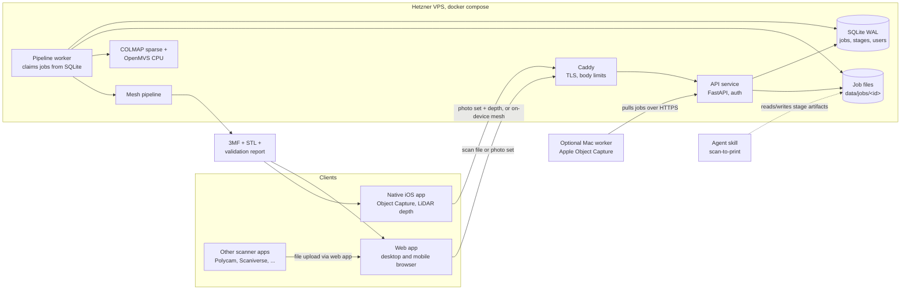

# Architecture

> Status: proposal (v0.2, hosted on Hetzner VPS, photogrammetry and iOS in phase 1). Decisions marked **[Decision]** are open for review before implementation starts.

## 1. Goal

Turn a physical object into a **print-ready 3MF file** that imports cleanly into **Bambu Studio** (Bambu Lab printers).

Inspired by [wesbos/3d-model-anything](https://github.com/wesbos/3d-model-anything), which captures rooms with an iPhone (LiDAR, RoomPlan, posed photos) and lets an AI agent rebuild them as Three.js scenes through a measure, model, compare, iterate loop. This project keeps the two good ideas from it:

1. **"The app records the evidence"**: capture is separated from reconstruction, and the capture bundle is a versioned, documented contract.
2. **An agent skill for the hard cases**: a deterministic pipeline handles the common path, an agent skill guides iterative fixes when the pipeline is not enough.

What changes:

| 3d-model-anything | 3d-scan (this repo) |
| --- | --- |
| Rooms and interiors | Hand-sized to printer-bed-sized **objects** |
| RoomPlan + LiDAR mesh | Photogrammetry (Apple Object Capture or open source) |
| Output: Three.js scene for viewing | Output: **watertight, manifold, correctly scaled mesh in mm**, packaged as 3MF |
| Visual fidelity is the success metric | **Printability** is the success metric (manifold, scale, flat base, fits bed) |
| Agent models the room from scratch | Agent repairs the scan, or remodels functional parts parametrically |

## 2. Reality check (read before building)

Scanning to print has known failure modes. The architecture is shaped around them.

| Problem | Why it happens | Mitigation in this design |
| --- | --- | --- |
| Holes, open bottom | Underside not visible during capture | Flip-and-rescan support, hole filling, planar base cut |
| Non-manifold / self-intersecting mesh | Photogrammetry output is a surface, not a solid | Repair stage (`manifold3d` / PyMeshLab) and a hard validation gate |
| Wrong scale | Photos alone have no metric scale | LiDAR depth (Object Capture), or user-entered reference dimension |
| Too many triangles | Scans produce 1M+ faces | Decimation to a target face count with an error bound |
| Shiny, transparent, thin, featureless objects | Photogrammetry needs texture | Capture guide (matte spray, markers); documented as unsupported |
| Dimensional accuracy (typically ~0.5 to 2 mm) | Inherent to consumer scanning | For functional parts: use scan as reference and remodel in CAD (agent skill, phase 4) |
| Color in Bambu Studio | Bambu Studio loads non-Bambu 3MF as "geometry data only" | Color is a **research spike** (issue), not an MVP promise. MVP is single-material geometry |

## 3. System overview



**Hosted on your Hetzner VPS.** One `docker compose` stack: Caddy (TLS), API, worker, SQLite on a local volume. SQLite in WAL mode with a single worker process is a good fit for one VPS and one user or a small group. Do not run more than one writer host.

### 3.1 Where does reconstruction run?

This is the main constraint of the whole design, so it is spelled out. The VPS is a **4 GB RAM Ampere (arm64)** server, so it is the weakest compute option, not the strongest.

| Path | Runs on | Quality | Scale | Notes |
| --- | --- | --- | --- | --- |
| A. On-device Object Capture | iPhone/iPad with LiDAR (A14+) | Reduced detail only | Metric (from sensors) | No server compute. Needs the iOS app |
| C. Apple Object Capture, full detail | The maintainer's **Mac** (Apple Silicon) as a **remote worker** that pulls jobs from the API | Best | Metric | **Primary path for good photo reconstruction.** Object Capture does not run on Linux, so never on the VPS. The Mac must be on and awake for jobs to run |
| B. COLMAP sparse + OpenMVS (CPU) | The VPS | Acceptable for small, well-textured sets | **No metric scale** unless poses come from the iOS bundle (#35) or a reference dimension is given | **Fallback with strict limits** (see 3.2). COLMAP's own dense stage needs CUDA, so OpenMVS runs on CPU. No official arm64 images, so both are built from source for arm64 |
| D. Bigger or GPU server | Hetzner larger cloud server, or dedicated GEX line | Fast | As B | Not planned. A GEX45 was about 214 EUR/month plus setup excl. VAT at the time of writing (verify). Only consider with real data from B |

**Recommendation:** ship A and C as the main photo paths and B as a limited fallback, all in phase 1. Revisit D only if B and C prove insufficient.

### 3.2 Hosting constraints (4 GB RAM, Ampere arm64)

- **Memory budget:** roughly 1 GB for OS, Caddy, API and SQLite, leaving about 3 GB for one job at a time. Add a swap file as a safety net (slow, not a plan). Jobs run with a memory limit so one bad upload cannot take the whole server down.
- **Photo fallback limits (starting points, to be set by the benchmark in #22):** about 20 to 40 images, downscaled to roughly 1600 px on the long side, OpenMVS resolution level 1 or 2. OpenMVS memory use grows quickly with image size and count, and densify is the usual out-of-memory step.
- **Mesh pipeline limits:** scans can have millions of faces. Decimate to a working size right after `ingest` (before repair) so PyMeshLab never sees a huge mesh. Reject or pre-simplify inputs above a face and file-size limit.
- **arm64 compatibility (checked against PyPI):** wheels exist for `pymeshlab` (needs glibc 2.35 or newer, so use Ubuntu 22.04 or newer as base image), `manifold3d`, `usd-core`, `numpy`, `scipy`, `trimesh`, `fast-simplification`, `pymeshfix`, `pillow-heif`. **No aarch64 Linux wheel for `lib3mf`**, so the production 3MF writer is our own small writer (core spec) and `lib3mf` is only a validator in x86_64 CI and local tests. Re-check versions when building, wheels change.
- **Images:** all containers must be multi-arch or arm64. Developer Macs on Apple Silicon are also arm64, so local and VPS images match.
- **Queue fairness:** with a few invited users, one job runs at a time and the UI shows queue position.

## 4. Components

### 4.1 `apps/web`: React frontend

- **Stack:** React + TypeScript + Vite, **TanStack Query v5** (server state, job polling via `refetchInterval`), **React Router v7** (SPA / data mode), **@react-three/fiber + drei** for the 3D viewer.
- **Responsibilities:**
  - Upload scans or photo sets, create jobs.
  - Show job progress per pipeline stage.
  - 3D preview with before/after per stage, wireframe, highlighted non-manifold edges and holes.
  - Interactive fixes the pipeline cannot guess: pick a face to lay flat on the bed, set a known dimension ("this edge is 42.0 mm"), choose printer, choose decimation target.
  - Validation report and download of 3MF / STL.
- **Rule:** no mesh processing logic in the browser. The browser renders and collects user intent, the pipeline computes. This keeps one source of truth for geometry.

### 4.2 `services/api`: FastAPI service

- HTTP layer: auth, jobs, uploads, stage parameters, artifact download, and a worker protocol for remote workers (claim, heartbeat, upload result).
- Owns the **OpenAPI contract**. TypeScript types for the web app are generated from it (`openapi-typescript`), never hand-written. The iOS app uses the same OpenAPI document (generated Swift client or a small hand-written client checked against it).
- Persists job and stage state in SQLite (WAL). Stores files under `data/jobs/<jobId>/`.
- **Auth is required now** because the service is reachable on the internet: session login for the web app, per-device API tokens for the iOS app and remote workers (see #32).
- **Large uploads:** photo sets can be several hundred MB. Use resumable uploads and per-user quotas with retention cleanup (see #33).

### 4.3 `services/pipeline`: mesh pipeline (Python package)

The core of the project. A sequence of **pure, individually testable stages**. Each stage reads a mesh plus parameters and writes a new mesh plus a JSON report. Stages never mutate earlier artifacts, so any stage can be re-run with new parameters (from the UI or the agent) without redoing reconstruction.

```
ingest -> reconstruct? -> normalize -> clean -> repair -> scale -> orient -> decimate -> validate -> export
```

| Stage | Input | Does | Key libs |
| --- | --- | --- | --- |
| `ingest` | upload | Detect format, convert USDZ/GLB/OBJ/PLY to an internal mesh, read capture manifest | `trimesh`, `usd-core` |
| `reconstruct` | photo set | Delegate to a `Reconstructor` adapter (only for photo input) | adapters |
| `normalize` | mesh | Units to mm, +Z up (Bambu convention), center on origin | `trimesh` |
| `clean` | mesh | Remove ground plane / turntable, keep largest component(s), drop floaters | `trimesh`, `pymeshlab` |
| `repair` | mesh | Fill holes, fix normals and winding, remove self-intersections, make watertight | `pymeshlab`, `pymeshfix`, `manifold3d` |
| `scale` | mesh | Apply metric scale from LiDAR metadata or user reference dimension | `numpy` |
| `orient` | mesh | Find a stable flat base (convex hull faces), optional planar base cut, drop to Z=0 | `trimesh` |
| `decimate` | mesh | Quadric decimation to target face count with max deviation check. Also runs early as a cheap pre-simplify on huge inputs to protect memory | `pymeshlab`, `fast-simplification` |
| `validate` | mesh | Manifold, watertight, volume > 0, fits printer bed, min feature hints | `trimesh`, `manifold3d` |
| `export` | mesh | Write 3MF (core spec, `unit="millimeter"`) and STL with our own writer (no `lib3mf` on arm64) | `lxml` or stdlib `zipfile` + `xml`; `lib3mf` only in tests |

**[Decision] Python for the pipeline.** The mesh processing ecosystem (trimesh, PyMeshLab, manifold3d, Open3D, lib3mf) is far stronger in Python than in .NET or TypeScript. C# was considered (the maintainer's other stack), but would mean writing repair algorithms ourselves.

### 4.4 Reconstructor adapters (photo input)

```python
class Reconstructor(Protocol):
    name: str
    def available(self) -> bool: ...
    def reconstruct(self, images_dir: Path, out_dir: Path, opts: ReconstructOptions) -> ReconstructResult: ...
```

| Adapter | Where it runs | Notes |
| --- | --- | --- |
| `colmap-openmvs` | VPS worker, CPU | Default for photo sets. No metric scale on its own |
| `apple-object-capture` | Remote Mac worker (optional) | Full detail, metric scale. Picks up jobs flagged `reconstructor=apple` |
| `ios-on-device` | Not an adapter: the iOS app uploads a finished USDZ, which enters at `ingest` | Reduced detail, metric scale |

The worker picks the adapter requested by the job, or the first available one.

### 4.5 `apps/capture-ios`: native capture app (phase 1)

SwiftUI + RealityKit `ObjectCaptureSession` (guided capture, flip support, LiDAR depth). Requires iPhone/iPad with LiDAR and A14 or later. Two upload modes:

1. **On-device mesh:** reconstruct on the phone (reduced detail), upload the USDZ. Fast, metric scale.
2. **Raw bundle:** upload images, depth, ARKit camera poses and a manifest (`capture-bundle/1`) for server or Mac reconstruction. Better detail, and the poses can give COLMAP a metric scale (research task #35).

The app logs in with a device token (#32), uploads with resumable uploads (#33), polls job status, and shows the result with a share sheet for the 3MF (open in Bambu Studio on a Mac or via Files).

Practical constraints: building and signing needs a Mac with Xcode and an Apple Developer account (TestFlight for distribution, see #34). Claude can write the Swift code via issues, but cannot run it, so every iOS PR needs a manual device test by you.

The web app also accepts photo sets from a **mobile browser** (multi-select file input). That is plain upload, not guided capture.

### 4.6 `.agents/skills/scan-to-print`: agent skill

Mirrors `scan-to-threejs` from the reference repo, adapted to printing. Guides an agent (Claude Code etc.) to:

1. Read the job's stage reports and validation failures.
2. Re-run stages with adjusted parameters (e.g. a more aggressive clean, a different base cut height).
3. Render comparison views (scan vs. repaired) and inspect them.
4. For functional parts: measure the scan and write a **parametric model** (CadQuery or OpenSCAD) that is dimensionally exact, then export via the same `export` stage.

## 5. Data contracts

### 5.1 Capture bundle (`capture-bundle/1`)

```
capture.zip
  manifest.json        { format: "capture-bundle/1", source, device, units, scaleHint?, createdAt }
  images/NNNN.heic|jpg
  depth/NNNN.tiff      optional (LiDAR)
  mesh/model.usdz|glb  optional (pre-reconstructed scan)
```

A plain scan file (USDZ/GLB/OBJ/PLY) is also accepted and wrapped in a synthetic manifest by `ingest`.

### 5.2 Job layout on disk

```
data/jobs/<jobId>/
  job.json                         status, params, timestamps
  input/                           original upload, never modified
  stages/<NN>-<stage>/
    mesh.ply                       output mesh
    report.json                    metrics, warnings, params used
    preview.glb                    lightweight mesh for the web viewer
  export/
    <name>.3mf
    <name>.stl
    validation.json
```

### 5.3 3MF output

- Core 3MF spec, `unit="millimeter"`, one object per mesh, metadata (`Title`, `Application`, `CreationDate`).
- Validated by re-reading with `lib3mf` in x86_64 CI and local tests (no arm64 Linux wheel exists), and by an import smoke test in Bambu Studio (manual checklist until automated).
- **Not in MVP:** Bambu project 3MF (plates, `Metadata/model_settings.config`, filament settings) and multi-color painting. Both are tracked as research issues.

## 6. Printer profiles

`packages/printer-profiles/*.json`: build volume and metadata per printer. Data, not code, so new printers are a JSON change. Values must be verified against the official [Bambu Lab compare page](https://bambulab.com/en-us/compare) and [wiki](https://wiki.bambulab.com/en/knowledge-sharing/print-volume-limitations). Known baseline: X1/P1/A1 series 256 x 256 x 256 mm, A1 mini 180 x 180 x 180 mm. H2-series and newer models must be checked (single vs. dual nozzle volumes differ).

## 7. Repository layout

```
3d-scan/
  apps/
    web/                         React + TS + Vite
      src/
        app/                     router, providers, layout
        features/
          jobs/                  api hooks, components, pages
          viewer/                R3F scene, controls, overlays
          upload/
        shared/
          api/                   generated OpenAPI types + fetch client
          ui/                    presentational components
          styles/                tokens, global CSS
    capture-ios/                 phase 1, Swift
  services/
    api/                         FastAPI app (routes, schemas, persistence)
    pipeline/                    Python package
      src/scan3d_pipeline/
        stages/                  one module per stage
        reconstructors/          adapter implementations
        io/                      formats, 3MF writer
        models.py                Mesh, StageResult, Report types
      tests/
        fixtures/                small reference meshes
    reconstructor-macos/         optional remote Mac worker, Swift CLI wrapping PhotogrammetrySession
  packages/
    printer-profiles/            JSON printer definitions
  .agents/skills/scan-to-print/  SKILL.md + scripts + references
  docs/
    ARCHITECTURE.md
    IMPLEMENTATION_PLAN.md
    adr/                         architecture decision records
  data/                          gitignored, local jobs
  deploy/                        docker-compose.yml, Caddyfile, backup scripts, runbook
  CLAUDE.md
```

## 8. Cross-cutting concerns

- **Testing:** pipeline stages are unit-tested against small fixture meshes (cube with hole, non-manifold mesh, mis-scaled mesh). Golden tests check the 3MF output parses and is manifold. Web uses Vitest + Testing Library. API has contract tests. iOS has unit tests for the client and manifest code, plus a manual device checklist.
- **CI:** GitHub Actions. Lint + typecheck + tests for web, ruff + mypy + pytest for Python, `xcodebuild` on a macOS runner for iOS (build and unit tests only).
- **Observability:** each stage writes timings and metrics in `report.json`. Structured JSON logs. Uptime check and disk-space alert on the VPS.
- **Security (hosted):** TLS only (Caddy), auth on every route except health, upload size limits at Caddy and API, zip-slip protection on archives, no execution of uploaded content, rate limiting on login and upload, worker and pipeline run as a non-root container user with CPU/memory limits and per-job timeouts. Mesh and photo parsers handle untrusted input, so keep their dependencies updated.
- **Backups and retention:** SQLite backed up continuously or nightly (for example Litestream or `sqlite3 .backup`) to a separate location such as a Hetzner Storage Box or S3-compatible storage. Job files are expendable after a retention period, 3MF exports are kept longer.
- **Performance:** all mesh and photogrammetry work runs in the worker, never in an API request. The viewer always loads the decimated `preview.glb`, not the full mesh. Reconstruction jobs are queued one at a time on the VPS to avoid running out of RAM.

## 9. Decisions and open questions

**Decided**
- Hosted on a Hetzner VPS: 4 GB RAM, Ampere (arm64). Confirm the exact plan and vCPU count with `nproc` and `free -m`, the benchmark depends on it.
- Users: a few invited people. No public sign-up, invite by CLI or link, small per-user quotas.
- The maintainer has a Mac and an Apple Developer account, so the iOS app and the Mac worker are unblocked.
- **The Mac is usually on**, so the Mac worker is the default for photo jobs (`reconstructor=auto` prefers it). Offline handling stays (job waits with a visible reason, user can switch to the VPS fallback), but it is the exception, not the main flow.
- **First target printer: Bambu Lab P1S** (build volume 256 x 256 x 256 mm, to be re-verified in the printer profile, #8). The import checklist (#14) and the printer profile are done for the P1S first. Other printers follow as data-only profiles.
- **Multi-color via AMS is a nice-to-have, not a must-have.** The MVP stays single-material geometry. Color remains a research task (#28) in phase 2. Users can assign filaments in Bambu Studio by hand.

**Still open**
1. Main use case: decorative objects (scan fidelity matters) or functional parts (dimensional accuracy matters)? This decides how early the parametric remodel path (#27) is needed.
2. Which Bambu Studio version is installed on the Mac, so the import checklist records it?
