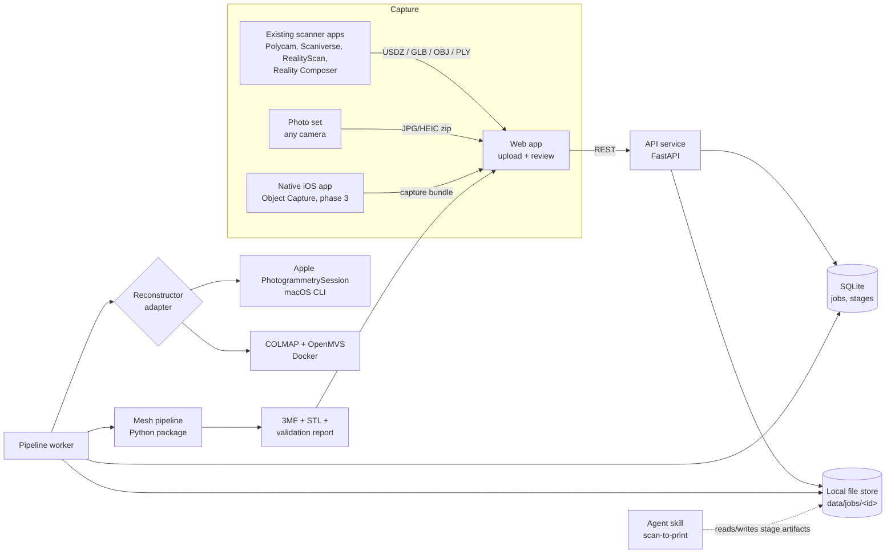

# Architecture

> Status: proposal (v0.1). Decisions marked **[Decision]** are open for review before implementation starts.

## 1. Goal

Turn a physical object into a **print-ready 3MF file** that imports cleanly into **Bambu Studio** (Bambu Lab printers).

Inspired by [wesbos/3d-model-anything](https://github.com/wesbos/3d-model-anything), which captures rooms with an iPhone (LiDAR, RoomPlan, posed photos) and lets an AI agent rebuild them as Three.js scenes through a measure, model, compare, iterate loop. This project keeps the two good ideas from it:

1. **"The app records the evidence"**: capture is separated from reconstruction, and the capture bundle is a versioned, documented contract.
2. **An agent skill for the hard cases**: a deterministic pipeline handles the common path, an agent skill guides iterative fixes when the pipeline is not enough.

What changes:

| 3d-model-anything | 3d-scan (this repo) |
| --- | --- |
| Rooms and interiors | Hand-sized to printer-bed-sized **objects** |
| RoomPlan + LiDAR mesh | Photogrammetry (Apple Object Capture or open source) |
| Output: Three.js scene for viewing | Output: **watertight, manifold, correctly scaled mesh in mm**, packaged as 3MF |
| Visual fidelity is the success metric | **Printability** is the success metric (manifold, scale, flat base, fits bed) |
| Agent models the room from scratch | Agent repairs the scan, or remodels functional parts parametrically |

## 2. Reality check (read before building)

Scanning to print has known failure modes. The architecture is shaped around them.

| Problem | Why it happens | Mitigation in this design |
| --- | --- | --- |
| Holes, open bottom | Underside not visible during capture | Flip-and-rescan support, hole filling, planar base cut |
| Non-manifold / self-intersecting mesh | Photogrammetry output is a surface, not a solid | Repair stage (`manifold3d` / PyMeshLab) and a hard validation gate |
| Wrong scale | Photos alone have no metric scale | LiDAR depth (Object Capture), or user-entered reference dimension |
| Too many triangles | Scans produce 1M+ faces | Decimation to a target face count with an error bound |
| Shiny, transparent, thin, featureless objects | Photogrammetry needs texture | Capture guide (matte spray, markers); documented as unsupported |
| Dimensional accuracy (typically ~0.5 to 2 mm) | Inherent to consumer scanning | For functional parts: use scan as reference and remodel in CAD (agent skill, phase 4) |
| Color in Bambu Studio | Bambu Studio loads non-Bambu 3MF as "geometry data only" | Color is a **research spike** (issue), not an MVP promise. MVP is single-material geometry |

## 3. System overview



**Local-first.** Runs on the user's machine (`docker compose up`, plus an optional native macOS reconstructor). No cloud dependency, no accounts. A hosted variant can come later, the boundaries below allow it.

## 4. Components

### 4.1 `apps/web`: React frontend

- **Stack:** React + TypeScript + Vite, **TanStack Query v5** (server state, job polling via `refetchInterval`), **React Router v7** (SPA / data mode), **@react-three/fiber + drei** for the 3D viewer.
- **Responsibilities:**
  - Upload scans or photo sets, create jobs.
  - Show job progress per pipeline stage.
  - 3D preview with before/after per stage, wireframe, highlighted non-manifold edges and holes.
  - Interactive fixes the pipeline cannot guess: pick a face to lay flat on the bed, set a known dimension ("this edge is 42.0 mm"), choose printer, choose decimation target.
  - Validation report and download of 3MF / STL.
- **Rule:** no mesh processing logic in the browser. The browser renders and collects user intent, the pipeline computes. This keeps one source of truth for geometry.

### 4.2 `services/api`: FastAPI service

- Thin HTTP layer: jobs, uploads, stage parameters, artifact download.
- Owns the **OpenAPI contract**. TypeScript types for the web app are generated from it (`openapi-typescript`), never hand-written.
- Persists job and stage state in SQLite. Stores files under `data/jobs/<jobId>/`.

### 4.3 `services/pipeline`: mesh pipeline (Python package)

The core of the project. A sequence of **pure, individually testable stages**. Each stage reads a mesh plus parameters and writes a new mesh plus a JSON report. Stages never mutate earlier artifacts, so any stage can be re-run with new parameters (from the UI or the agent) without redoing reconstruction.

```
ingest -> reconstruct? -> normalize -> clean -> repair -> scale -> orient -> decimate -> validate -> export
```

| Stage | Input | Does | Key libs |
| --- | --- | --- | --- |
| `ingest` | upload | Detect format, convert USDZ/GLB/OBJ/PLY to an internal mesh, read capture manifest | `trimesh`, `usd-core` |
| `reconstruct` | photo set | Delegate to a `Reconstructor` adapter (only for photo input) | adapters |
| `normalize` | mesh | Units to mm, +Z up (Bambu convention), center on origin | `trimesh` |
| `clean` | mesh | Remove ground plane / turntable, keep largest component(s), drop floaters | `trimesh`, `pymeshlab` |
| `repair` | mesh | Fill holes, fix normals and winding, remove self-intersections, make watertight | `pymeshlab`, `manifold3d` |
| `scale` | mesh | Apply metric scale from LiDAR metadata or user reference dimension | `numpy` |
| `orient` | mesh | Find a stable flat base (convex hull faces), optional planar base cut, drop to Z=0 | `trimesh` |
| `decimate` | mesh | Quadric decimation to target face count with max deviation check | `pymeshlab` |
| `validate` | mesh | Manifold, watertight, volume > 0, fits printer bed, min feature hints | `trimesh`, `manifold3d` |
| `export` | mesh | Write 3MF (core spec, `unit="millimeter"`) and STL | `lib3mf` |

**[Decision] Python for the pipeline.** The mesh processing ecosystem (trimesh, PyMeshLab, manifold3d, Open3D, lib3mf) is far stronger in Python than in .NET or TypeScript. C# was considered (the maintainer's other stack), but would mean writing repair algorithms ourselves.

### 4.4 Reconstructor adapters (photo input only)

```python
class Reconstructor(Protocol):
    name: str
    def available(self) -> bool: ...
    def reconstruct(self, images_dir: Path, out_dir: Path, opts: ReconstructOptions) -> ReconstructResult: ...
```

| Adapter | Where it runs | Pros | Cons |
| --- | --- | --- | --- |
| `apple-object-capture` | macOS (Apple Silicon), small Swift CLI using `PhotogrammetrySession` | Best quality, uses LiDAR depth for scale, "full"/"raw" detail on Mac | Mac only |
| `colmap-openmvs` | Docker (CPU, CUDA optional) | Cross-platform, open source | Slower, no metric scale without reference |

The worker picks the first available adapter, or the one the user selects.

### 4.5 `apps/capture-ios`: native capture app (phase 3, optional)

SwiftUI + RealityKit `ObjectCaptureSession` (guided capture, flip support, LiDAR depth). Requires iPhone/iPad with LiDAR and A14 or later. On-device reconstruction is reduced detail only, so the app **exports the raw image set + depth + a manifest** (`capture-bundle/1`) and lets the Mac adapter do full-detail reconstruction.

Built last on purpose: existing free scanner apps already cover capture, so the native app is only worth it once the pipeline proves itself.

### 4.6 `.agents/skills/scan-to-print`: agent skill

Mirrors `scan-to-threejs` from the reference repo, adapted to printing. Guides an agent (Claude Code etc.) to:

1. Read the job's stage reports and validation failures.
2. Re-run stages with adjusted parameters (e.g. a more aggressive clean, a different base cut height).
3. Render comparison views (scan vs. repaired) and inspect them.
4. For functional parts: measure the scan and write a **parametric model** (CadQuery or OpenSCAD) that is dimensionally exact, then export via the same `export` stage.

## 5. Data contracts

### 5.1 Capture bundle (`capture-bundle/1`)

```
capture.zip
  manifest.json        { format: "capture-bundle/1", source, device, units, scaleHint?, createdAt }
  images/NNNN.heic|jpg
  depth/NNNN.tiff      optional (LiDAR)
  mesh/model.usdz|glb  optional (pre-reconstructed scan)
```

A plain scan file (USDZ/GLB/OBJ/PLY) is also accepted and wrapped in a synthetic manifest by `ingest`.

### 5.2 Job layout on disk

```
data/jobs/<jobId>/
  job.json                         status, params, timestamps
  input/                           original upload, never modified
  stages/<NN>-<stage>/
    mesh.ply                       output mesh
    report.json                    metrics, warnings, params used
    preview.glb                    lightweight mesh for the web viewer
  export/
    <name>.3mf
    <name>.stl
    validation.json
```

### 5.3 3MF output

- Core 3MF spec, `unit="millimeter"`, one object per mesh, metadata (`Title`, `Application`, `CreationDate`).
- Validated by re-reading with `lib3mf` and by an import smoke test in Bambu Studio (manual checklist until automated).
- **Not in MVP:** Bambu project 3MF (plates, `Metadata/model_settings.config`, filament settings) and multi-color painting. Both are tracked as research issues.

## 6. Printer profiles

`packages/printer-profiles/*.json`: build volume and metadata per printer. Data, not code, so new printers are a JSON change. Values must be verified against the official [Bambu Lab compare page](https://bambulab.com/en-us/compare) and [wiki](https://wiki.bambulab.com/en/knowledge-sharing/print-volume-limitations). Known baseline: X1/P1/A1 series 256 x 256 x 256 mm, A1 mini 180 x 180 x 180 mm. H2-series and newer models must be checked (single vs. dual nozzle volumes differ).

## 7. Repository layout

```
3d-scan/
  apps/
    web/                         React + TS + Vite
      src/
        app/                     router, providers, layout
        features/
          jobs/                  api hooks, components, pages
          viewer/                R3F scene, controls, overlays
          upload/
        shared/
          api/                   generated OpenAPI types + fetch client
          ui/                    presentational components
          styles/                tokens, global CSS
    capture-ios/                 phase 3, Swift
  services/
    api/                         FastAPI app (routes, schemas, persistence)
    pipeline/                    Python package
      src/scan3d_pipeline/
        stages/                  one module per stage
        reconstructors/          adapter implementations
        io/                      formats, 3MF writer
        models.py                Mesh, StageResult, Report types
      tests/
        fixtures/                small reference meshes
    reconstructor-macos/         Swift CLI wrapping PhotogrammetrySession
  packages/
    printer-profiles/            JSON printer definitions
  .agents/skills/scan-to-print/  SKILL.md + scripts + references
  docs/
    ARCHITECTURE.md
    IMPLEMENTATION_PLAN.md
    adr/                         architecture decision records
  data/                          gitignored, local jobs
  docker-compose.yml
  CLAUDE.md
```

## 8. Cross-cutting concerns

- **Testing:** pipeline stages are unit-tested against small fixture meshes (cube with hole, non-manifold mesh, mis-scaled mesh). Golden tests check the 3MF output parses and is manifold. Web uses Vitest + Testing Library. API has contract tests.
- **CI:** GitHub Actions. Lint + typecheck + tests for web, ruff + mypy + pytest for Python.
- **Observability:** each stage writes timings and metrics in `report.json`. Logs are structured JSON.
- **Security:** local-only by default (bind to 127.0.0.1). Upload size limits, zip-slip protection on archive extraction, no execution of uploaded content.
- **Performance:** large scans are processed in the worker, never in the API request. The viewer always loads the decimated `preview.glb`, not the full mesh.

## 9. Open questions

1. Is local-first enough, or is a hosted version a goal? (Affects auth, storage, queue choice.)
2. Is multi-color (AMS) output a must-have or a nice-to-have?
3. Primary capture device: iPhone with LiDAR, Android, or a regular camera?
4. Main use case: decorative objects (scan fidelity matters) or functional parts (dimensional accuracy matters)? This decides how early the parametric remodel path is needed.
