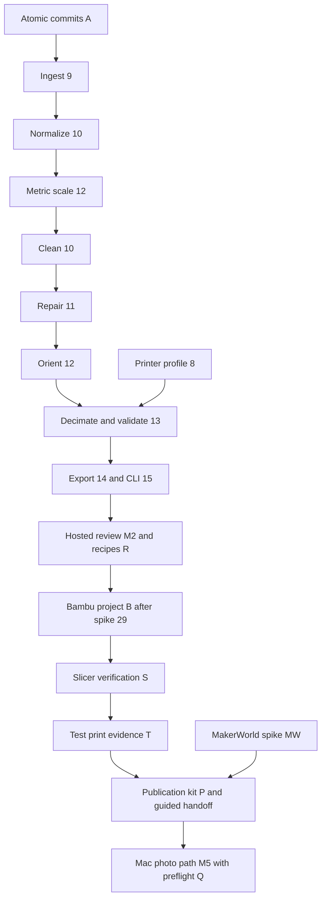

# Implementation plan

Revised 2026-10-31 against `main` at `17491ecd4729be807e4359a1a77e77c6c7c7822d`. Read [architecture](ARCHITECTURE.md), [assessment](REVIEW.md), [issue-ready work](BACKLOG.md), and [research](research/scan-to-publication.md).

This is a proposed issue/dependency map. Existing GitHub issue bodies, labels and parent relationships have not been changed. Symbolic IDs below are draft tasks, not allocated issue numbers. Apply the amendments in BACKLOG.md before asking an implementation agent to follow the old issue chain. #6 and #7 are closed; all other implementation issues remain open as inspected on 2026-10-31.

## Delivery order

| Milestone | Scope | Exit evidence |
| --- | --- | --- |
| M0: safe runner commits | A, a small follow-up to closed #7 | Failed exports and reruns never expose partial or mixed stage generations; prior completed output remains resumable. |
| M1: scan file to validated geometry | #8 to #15, A; begin with one GLB/PLY CLI slice | One real externally captured mesh and fixtures produce mm core 3MF/STL, validation and scale provenance. P1S-target Bambu import checklist passes manually. No project or publication claim yet. |
| M2: hosted guided review | R, extended #12/#11/#19/#20, #16 to #21/#32/#33 | Upload, several dimension checks, protected-feature repair review, stage comparison and affected-stage reruns work. VPS resource/restore checks recorded. |
| M3: Bambu project and slicer verification | Move #29 here; B, S | Exact validated model becomes a pinned-version Bambu project retaining geometry and selected settings. Project reopens and slices without manual rebuilding. Mac offline and failure handling work. |
| M4: test print and publication preparation | T, P, MW | P1S test print and genuine finished-print photos bind to a frozen project. Editable listing and one publication kit support a guided MakerWorld handoff. Later user-run publication and readback complete the product acceptance test. |
| M5: Mac photos to the same path | #3/#23/#24 plus Q | Preflight identifies affected photos before Mac reconstruction. Real captures with multiple physical measurements flow into the proven preparation path; quality/time/memory evidence recorded. |
| Later | #22/#35, #4/#25/#34, #5/#26/#27/#28/#30, MCP | Separately scoped, benchmarked work. None blocks M1 to M4. |

Sequence production delivery in this order. Small read-only spikes (#14 export choice, #29 CLI, MW feasibility) can retire risk earlier without building their whole features. Do not treat the original MVP's photos, native capture and constrained VPS photogrammetry as one required release.

## Revised issue and dependency map

An issue containing more than one stage can have separately mergeable parts. `#10 normalize`, `#12 scale`, and `#12 orient` below are parts of existing issues, not duplicate tasks. Do not close the parent until all its revised acceptance criteria pass.

| Existing issue or draft | Delivery | Prerequisites and revised scope |
| --- | --- | --- |
| #1 foundation epic | Foundation | #6/#7 done, #8 still open. |
| #6 workspace | Done | No reopening. |
| #7 runner/contracts | Done | Preserve completed scope; A is a focused follow-up. |
| A atomic stage commits | M0 | #7. Reader/writer contract and failure tests before production stages. |
| #8 printer profiles | M1 | #6. Verify P1S and usable margins first; other models later. |
| #9 ingest | M1 | #7, A. GLB/PLY first, then remaining format fixtures; bounded parsing, splat detection and original appearance retention. |
| #10 normalize | M1 | #9. Axes/declared units and explicit unknown-scale state. |
| #12 scale | M1/M2 | #10 normalize, not #11. Resolve size before mm thresholds. One reference in M1, several checks and residual review in M2. |
| #10 clean | M1/M2 | #12 scale. Conservative removals and protected-region handling; retained removal evidence. |
| #11 repair | M1/M2 | #10 clean. Conservative local repair in M1; constraints, section checks and reviewed alternatives in M2. Do not auto-remesh functional features before that review exists. |
| #12 orient | M1/M2 | #11. Rigid placement first; optional cuts require protected-feature checks and revalidation. |
| #13 decimate/validate | M1 | #12 orient, #8. Extend existing thin-wall warnings, separate dimensional status. |
| #14 geometry export | M1 | #13 and export-library spike in BACKLOG.md. Round-trip gate, no custom Bambu metadata. |
| #15 CLI | M1 | #14. Scan-to-export, resume, machine-readable reports, explicit scale and diagnostic output separation. |
| R reproducible recipes | M1 base, M2 complete | A, #15. Hashes/version capture with first CLI; branch/cache reuse and review UI in M2. |
| #16 API/OpenAPI | M2 | #7, A. Can define contracts while stages develop. Generate web types. |
| #32 auth | M2 | #16. Invite-only, ownership, worker scopes. |
| #33 resumable uploads/retention | M2 | #16/#32. Preserve tested/published revision parents and evidence. |
| #17 worker/queue | M2 | #15/#16/#32, A. Capability claims, fenced leases, filesystem/DB recovery. |
| #18 web uploads/jobs | M2 | #6/#16/#32/#33. Existing placeholder is not the completed issue. |
| #19 viewer/comparison | M2 | #18 and #11/#13 report contracts. Extend existing stage compare, never a second comparison feature. |
| #20 guided decisions/rerun | M2 | #19/#17, R; extended #12/#11. Size, repair, orientation, warnings; later print/publication steps. |
| #21 deployment/resource benchmark | M2 | #17/#18/#33. ARM64 peak-memory limits, timeouts, OOM recovery, backups and restore. Does not wait for #22. |
| #29 Bambu project spike | Early research, M3 gate | CLI prototype may use fixture; final artifact acceptance needs #14. Move from #5 to #2's main path. |
| B Bambu project adapter | M3 | #29 go decision, #14/#17/#32, R. Mac capability transport shared with later #23. |
| S pinned slicer verification | M3 | B. Independent result for exact project/configuration hashes. |
| T tested project and photo evidence | M4 | B, S, #16/#18/#33. Freeze tested revision and invalidate approval on project changes. |
| MW MakerWorld feasibility spike | Early research, M4 gate | Read-only work now; B/T for future asset/draft acceptance checks. No publishing in planning. |
| P listing/publication kit and handoff | M4 | T, #20, MW findings or explicit unverified checklist. Guided fallback does not depend on an undocumented API. |
| #2 main epic | M1 to M4 | Revise around external scan to P1S print and MakerWorld publication. Link #29/B/S/T/P/MW. |
| #3 photo epic | M5 | Rename to Mac-first photos, remove mandatory VPS fallback exit. |
| Q capture preflight | M5 | #33/#18. Shared QC module can be built with local images earlier; blocks expensive photo reconstruction pending review. |
| #23 Mac photo worker | M5 | #17/#32/#33, Q; reuse B's transport. Extract reconstructor contract from #22 here. |
| #24 capture guide | M1 initial, M5 measured update | Initial external-scan guide needs #9/#12; remove #22 as prerequisite. Add QC/real capture lessons with Q/#23. |
| #22 VPS photo fallback | Later | #23/#33/#21. Own CPU/ARM64/time/memory benchmark and explicit go/no-go. |
| #35 ARKit metric-scale spike | Later | #22 and a real pose bundle from #25. Synthetic tests must be labelled. |
| #4 native capture epic | Later | Proven hosted path and #23; no longer blocks main epic. |
| #25 native capture | Later | #16/#32/#33/#23; raw bundles use Mac first, not mandatory #22. |
| #34 iOS CI/TestFlight | Later | #25. Real device checks remain manual. |
| #5 advanced epic | Later | Remove #29; retain #26/#27/#28/#30 and later MCP. |
| #26 agent skill | Later | #15, R, stable validated rerun/compare/export. |
| #27 functional CAD/STEP | Later | #26 and measurement/constraint contracts. Deterministic feature checks, no scan accuracy guarantee. |
| #28 AMS research | Later | #14, #29, appearance-survival fixtures from #9. No palette UI before feasibility. |
| #30 oversize splitting | Later | #13/#14; project multi-plate support extends B after individual parts validate. |
| MCP, unallocated | Later | Stable #26 operations/auth. Create a task only when implementation is scheduled. |

The diagram is delivery order. The table gives implementation prerequisites. In particular, photo reconstruction is not an input dependency of publication preparation.

## Next smallest implementable milestone

Implement **A: atomic stage completion**, as one PR against the existing identity runner. Do not add ingest, FastAPI, recipes or publishing in that PR.

A successful two-stage run publishes complete outputs; an exception while writing PLY, GLB, report or completion metadata publishes nothing for that attempt. A failed rerun preserves the prior committed generation, readers reject partial/tampered artifacts, and upstream artifacts remain byte-for-byte unchanged. Include crash/restart injection and a short old-layout migration note. This is a small, measurable prerequisite for reliable resumption and recipes.

The next user-visible milestone is M1. Start with a known-scale GLB/PLY fixture and P1S profile, then add one real external scan. Keep OBJ/USDZ support and advanced warnings as incremental parts of their existing issues, without claiming #9/#13 complete early.

## Principal product acceptance

An externally captured object scan becomes a validated model and Bambu Studio project, prints successfully on the P1S, receives a genuine photograph of the finished print, and is published on MakerWorld without manually rebuilding the project or writing the listing from scratch.

Use the [verification ledger](VERIFICATION.md) to record each revision, operator, tool version, evidence and unresolved result. M4 preparation can ship with guided manual transfer; public acceptance remains pending until a user-authorized real publication is read back. Upload success, a private draft, slicing and a physical print are distinct outcomes. No MakerWorld content is published by this planning task.

## Working on the backlog

Use [BACKLOG.md](BACKLOG.md) for amendments and missing-task descriptions. Keep the old issues as the tracking identities. Do not create duplicate dimension, comparison, thin-wall, splitting, CAD, AMS or skill issues. The repository's existing issue-triggered automation can implement individual tasks once their revised dependencies are merged. Review like any other PR, with manual Mac/P1S/MakerWorld evidence listed separately from automated tests.
